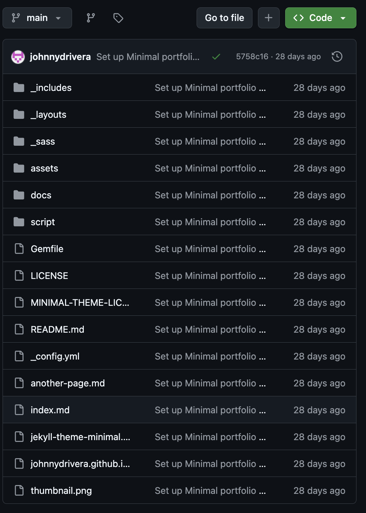
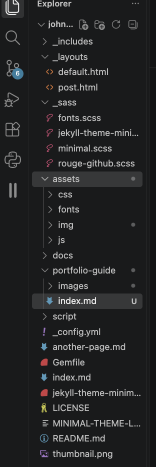
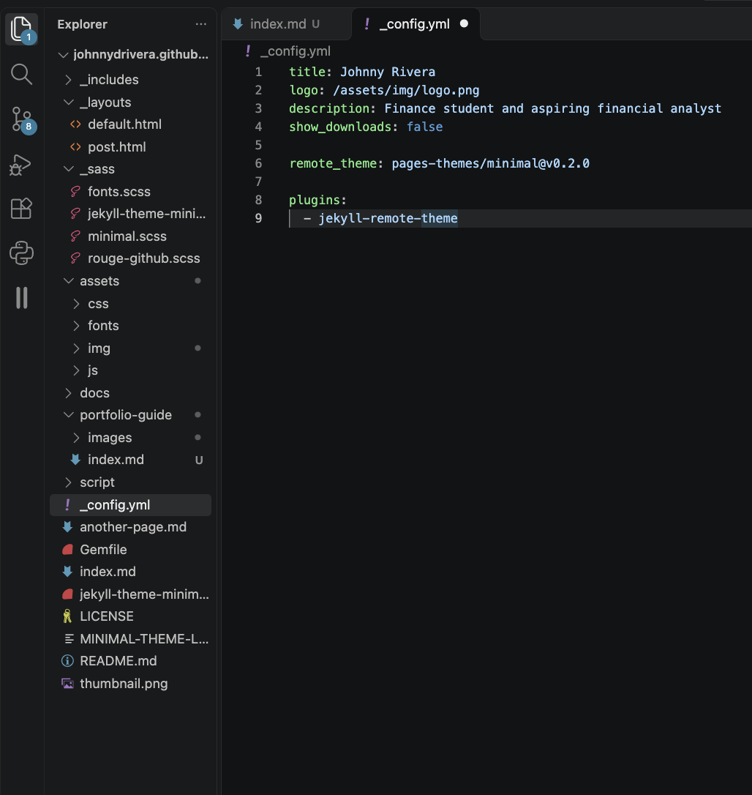
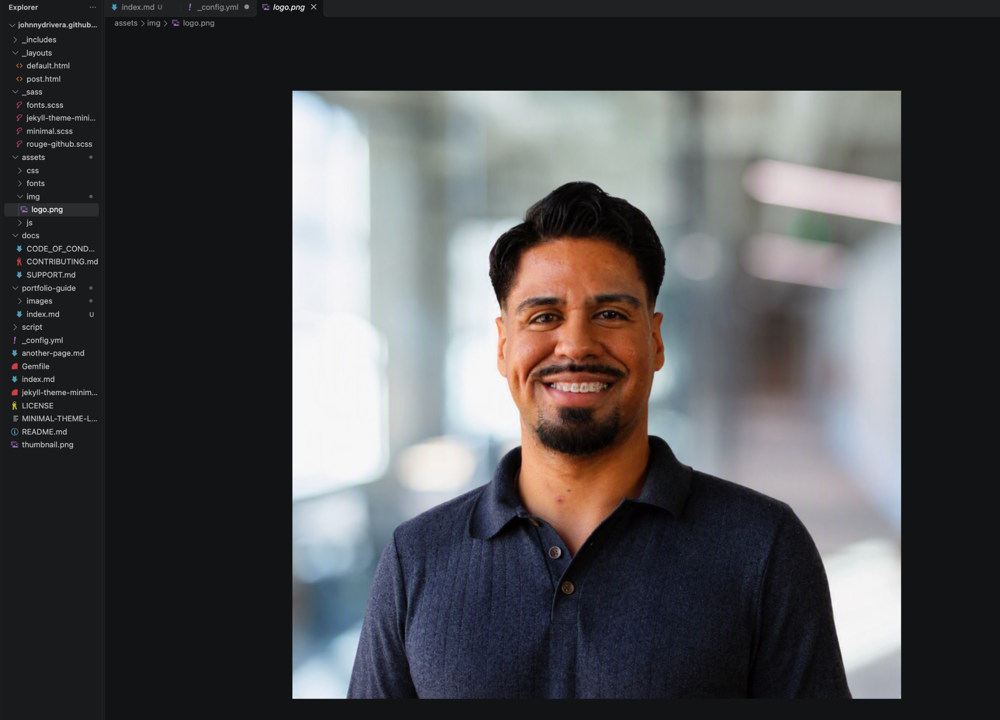
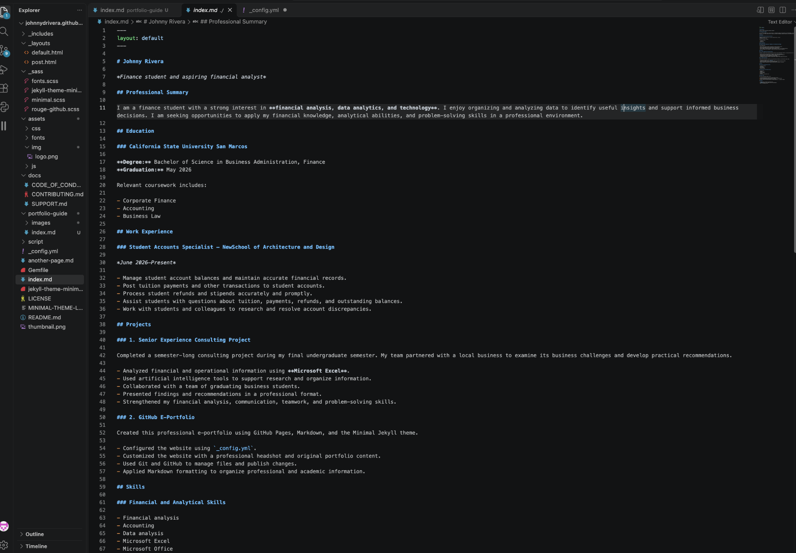

# How I Built My GitHub Pages E-Portfolio

## Introduction

An e-portfolio is a website that presents a person's education, experience, projects, skills, and professional goals. I created my e-portfolio with GitHub Pages so I could publish my professional information online while also learning about GitHub, Markdown, Jekyll, and website development.

This guide explains the steps I followed to create my e-portfolio, apply the Minimal Jekyll theme, customize the website, and publish it through GitHub Pages.

## Tools and Resources

I used the following tools and resources:

- [GitHub](https://github.com/) to store and publish my website files.
- [GitHub Pages](https://pages.github.com/) to host the website.
- [GitHub Desktop](https://desktop.github.com/) to manage commits and push changes.
- [Visual Studio Code](https://code.visualstudio.com/) to edit the website files.
- [Minimal Jekyll Theme](https://github.com/pages-themes/minimal) as the website template.
- [Markdown Guide](https://www.markdownguide.org/basic-syntax/) as a reference for Markdown formatting.

## Step 1: Creating the GitHub Pages Repository

### Creating the repository

I first created a GitHub repository named:

`johnnydrivera.github.io`

A personal GitHub Pages repository must follow the format `username.github.io`, using the account owner's GitHub username. This repository name allows GitHub Pages to publish the website at the matching web address.

My website is available at:

[https://johnnydrivera.github.io/](https://johnnydrivera.github.io/)

### Cloning the repository

I used GitHub Desktop to clone the repository to my computer. Cloning created a local copy of the repository that I could open and edit with Visual Studio Code.

The general process was:

1. Open the repository on GitHub.
2. Select **Code**.
3. Copy the HTTPS repository address.
4. Open GitHub Desktop.
5. Select **Clone a Repository**.
6. Choose the local location for the repository.



## Step 2: Downloading the Minimal Theme

I selected the [Minimal Jekyll theme](https://github.com/pages-themes/minimal) for my e-portfolio. The theme provides a simple professional layout with space for a profile image, website title, description, and main content.

Because I already had a repository named `johnnydrivera.github.io`, I downloaded the Minimal theme as a ZIP file instead of forking it.

To download the theme, I:

1. Opened the Minimal theme repository.
2. Selected the green **Code** button.
3. Selected **Download ZIP**.
4. Extracted the downloaded ZIP file.
5. Copied the required theme files into the root of my local portfolio repository.

The theme files included folders such as `_layouts`, `_sass`, and `assets`, along with files such as `_config.yml`, `Gemfile`, and `index.md`.



## Step 3: Configuring the Theme

I edited the `_config.yml` file to personalize the theme. This YAML file contains important website settings, including the website title, description, profile image, and selected theme.

My configuration included:

```yaml
title: Johnny Rivera
logo: /assets/img/logo.png
description: Finance student and aspiring financial analyst
show_downloads: false

remote_theme: pages-themes/minimal@v0.2.0

plugins:
  - jekyll-remote-theme
```

The `title` setting displays my name, while `description` provides a short professional statement. The `logo` setting tells the theme where to locate my profile image. I disabled download links because they were not necessary for my portfolio.



## Step 4: Replacing the Theme Image

The Minimal theme included a stock image named `logo.png`. I replaced this image with my professional headshot.

I converted my headshot to PNG format, renamed it `logo.png`, and placed it in:

`assets/img/logo.png`

Keeping the same filename allowed the theme to display my headshot without requiring additional changes to the layout.



## Step 5: Customizing the Main Portfolio Page

I replaced the sample content in the root `index.md` file with my own professional information.

I organized the page into the following sections:

- Professional Summary
- Education
- Work Experience
- Projects
- Skills
- Career Goals
- Contact Information

I used several types of Markdown formatting, including:

1. Level-one, level-two, and level-three headers
2. Bold text
3. Italic text
4. Ordered lists
5. Unordered lists
6. Links
7. Inline code

For example, Markdown headers use number signs:

```markdown
# Main Heading
## Section Heading
### Subsection Heading
```

Links use brackets and parentheses:

```markdown
[GitHub Profile](https://github.com/johnnydrivera)
```



## Step 6: Saving and Publishing the Website

After completing my changes, I reviewed the files in GitHub Desktop. I made sure that unnecessary files, including `.DS_Store` files and downloaded ZIP files, were not included in the commit.

I then:

1. Added a descriptive commit summary.
2. Committed the changes to the `main` branch.
3. Selected **Push origin** to upload the changes to GitHub.
4. Opened the repository on GitHub.
5. Selected the **Actions** tab.
6. Confirmed that the Pages build and deployment completed successfully.

GitHub Pages automatically rebuilt the website after the changes were pushed.

## Step 7: Reviewing the Published Portfolio

After the deployment completed, I visited my live website to confirm that:

- The Minimal theme displayed correctly.
- My professional headshot appeared.
- My résumé information was properly organized.
- The headings, lists, links, and other Markdown formatting worked.
- The website was readable on the published page.

The final website can be viewed at:

[Visit Johnny Rivera's E-Portfolio](https://johnnydrivera.github.io/)


## Conclusion

Creating this e-portfolio helped me learn how GitHub repositories, GitHub Pages, Jekyll themes, YAML configuration, and Markdown work together. I also gained experience managing files, creating commits, troubleshooting folder structures, and publishing updates to a live website.

The completed portfolio provides one location where I can present my education, professional experience, projects, technical skills, and future accomplishments.

[Return to the main portfolio](https://johnnydrivera.github.io/)